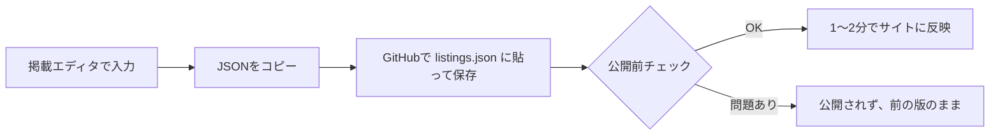

# Siopa Ceoil — 中古 笛とボックスの譲り場

アイリッシュ音楽の中古の笛（ティンホイッスル・ローホイッスル・アイリッシュフルート）とボックス（コンサーティーナ・メロディオン）を預かり、清掃・試奏してから販売・レンタルする委託ショップのサイトです。

- 公開URL：https://kikka51.github.io/siopa-ceoil/
- 掲載エディタ：https://kikka51.github.io/siopa-ceoil/tools/editor.html

## しくみ



サイトは静的なファイルだけでできていて、サーバーもログイン画面もありません。掲載や設定を変えるのは GitHub 上のファイルを書き換えたときだけで、書き換えるたびに自動チェックが走り、通ったものだけが公開されます。

## 掲載を追加・変更する

1. 掲載エディタを開き、フォームに入力して「一覧に追加」（編集・削除も一覧からできる）
2. 下の「GitHubに貼るJSON」が緑（チェックに通る内容）になったら「JSONをコピー」
3. 「GitHubで listings.json を開く」から、中身を全部消して貼り付け、「Commit changes」で保存
4. リポジトリの「Actions」タブで緑のチェックが付けば公開完了

スマホのブラウザからでもできます。エディタの作業中の内容は、そのブラウザにだけ下書きとして残ります。

## 開店する（委託の受付と販売・レンタルを始める）

古物商許可が下りたら、`site/data/settings.json` を次のように書き換えて保存します。

```json
"accepting": true,
"license": "古物商許可 香川県公安委員会 第000000000000号 ／ 運営者名",
"tokusho": {
  "seller": "販売業者の名前",
  "manager": "運営責任者の名前",
  "address": "",
  "phone": "",
  "email": "連絡先メール",
  "disclosureOnRequest": true
}
```

許可番号・販売業者・運営責任者・メールがそろっていないと、チェックで止まって開店できません（許可前に販売ボタンが出る事故を防ぐため）。住所と電話番号を載せない場合は `disclosureOnRequest: true` にすると「ご請求があれば遅滞なく開示します」と表示します。この扱いが自分のケースで認められるかは、念のため消費生活センターなどで確認してください。

## 設定（`site/data/settings.json`）

| 項目 | 意味 | 初期値 |
|---|---|---|
| `accepting` | 開店しているか。false の間は購入・レンタル・受付のボタンを出さない | false |
| `contact` | 問い合わせ先のXアカウント | @hiuchi2025 |
| `feeRate` / `feeMin` | 販売手数料（%）と最低手数料（円） | 20 / 1500 |
| `period` | 掲載期間（日） | 90 |
| `rentRate` / `rentMin` / `rentMonths` | レンタル月額（販売価格の%）、最低月額、最低期間（か月） | 5 / 1500 / 3 |
| `credit` / `creditWindow` | 購入時に充当するレンタル料の%と、充当できる期間（か月） | 50 / 6 |
| `ownerShare` | レンタル料のうち持ち主に払う% | 60 |
| `deposit` | 保証金（販売価格の%） | 20 |
| `license` | 古物商許可の表記（フッターと特商法ページに出る） | 空 |
| `tokusho` | 特定商取引法の表記 | 空 |

## Stripe の準備

- **購入**：商品ごとに支払いリンクを作り、`pay` に入れる。売れたらリンクを無効にして、掲載を「売約済」にする
- **レンタル**：定期支払いの支払いリンクを作り、支払い方法はカードのみにする。`rentpay` に入れる
- サイトに入れられるのは `https://buy.stripe.com/` で始まるリンクだけ（偽の支払いページへの誘導を防ぐため）
- **Stripe の秘密鍵（`sk_live_` など）は絶対にこのリポジトリに入れない**。入っているとチェックで止まる

## やってはいけないこと

- 出品者の氏名・住所・電話・メールを掲載データに入れる（公開されます。入っているとチェックで止まる）
- 木製の笛をレンタル可にする（チェックで止まる）
- `site/` に下書きや設定ファイルを置く（公開対象外の種類はチェックで止まる）

## 公開が止まったとき

リポジトリの「Actions」タブで赤い×が付いた実行を開き、「公開前チェック」の行を見ると、何がだめだったかが日本語で出ています。直して保存し直せば、もう一度チェックが走ります。止まっている間も、サイトは前の版のまま表示されています。

## ファイル構成

```
site/                  公開されるもの
  index.html           店頭
  tokushoho.html       特定商取引法に基づく表記
  tools/editor.html    掲載エディタ（何も保存・送信しない）
  assets/rules.js      掲載データの定義と検査ルール（サイトとチェックで共用）
  assets/app.js        店頭の表示
  data/listings.json   掲載データ
  data/settings.json   設定
scripts/validate.mjs   公開前チェック
.github/workflows/     チェックと公開の自動化
SECURITY.md            セキュリティ対策と注意点
```
